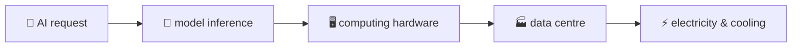
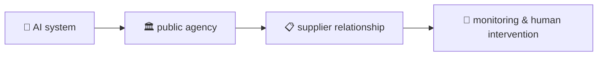
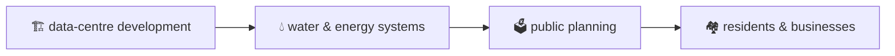

<div align="center">


# 🪐 Galaxy of AI

**A personal, exploratory map of artificial intelligence — and its connections to infrastructure, governance, economics, society, politics and the environment.**

[](sources/catalogue.csv)
[](sources/topics.csv)
[](sources/topic_links.csv)
[](#-run-the-checks)
[](#-explore)

*Open `galaxy.html` in a browser and drift. Select a planet for its topics, a topic for its explanation, and the astronaut for search and guided paths.*

</div>

---

## 🌌 What this is

A **learning map, not an authority**. One central AI concept, seven domains, thirty-eight topics that can belong to several domains at once, and source-linked connections between them — each link either **sourced** (tied to a record that was actually read) or an **association** (an open question, not a claim).

The first constellation sketch covers:

- 🤖 **AI foundations** — models, training, inference, data, evaluation, agents
- 🏛️ **People & institutions** — work, human judgment, public agencies, universities, organisational capacity
- ⚖️ **Governance & law** — oversight, procurement, accountability, regulation, standards
- 🔌 **Physical infrastructure** — chips, data centres, electricity, water, land, telecommunications
- 💰 **Economics & politics** — finance, ownership, industrial policy, international relations, development
- 🌱 **Environment** — energy systems, emissions, resources, environmental governance

These areas overlap. A connection means subjects are *related* — it does not automatically mean one causes another.

## 🧭 Three paths to explore

The guided routes in the interface each trace one thread through the map:







- **Question → physical infrastructure** — a general learning path; it does not identify where any particular request runs.
- **AI → institutional control** — what a particular agency can do depends on its actual arrangements.
- **Data centres → place** — local effects must be established case by case.

## 📚 How the research holds itself

- **Every record states its read-depth.** Full reads, page-level reads, abstract-level reads, metadata-only — the level is on the record, and metadata-only records are never cited for substantive claims.
- **Author conclusions are reported as author conclusions.** Something becomes "established" only through independent replication — which none of these sources has received.
- **Links are labelled.** Sourced edges name at least one actually-read record; association edges stay visibly open.
- **Corrections are kept, not smoothed over.** Contradicted claims, scope notes and discrepancies stay in the record alongside the original claim.

> [!IMPORTANT]
> Inclusion in the catalogue is **not** a guarantee of accuracy. Follow the linked sources and check their dates, methods and limits before relying on any claim.

## ✅ Run the checks

From the project root:

```bash
python3 sources/checks.py
```

```text
1. records: 1,001; duplicate ids: none
2. duplicate urls: none
3. topic_links: 70; broken refs: 0
4. topics: 38; topics w/o valid domain: none
   multi-domain topics: 28/38
8. catalogue.csv rows: 1,001; fields match json: True

RESULT: STRUCTURAL CHECKS PASS (source claims not verified)
```

## 📁 Where things live

```text
galaxy-of-ai/
├─ galaxy.html              the interactive map (current prototype)
├─ galaxy-scenes.html       scene-based view
├─ constellation.html       constellation view
├─ public-release/          standalone release — open index.html, no install or account
├─ sources/
│  ├─ catalogue.json / .csv the 1,001-record source catalogue
│  ├─ graph.json            domains, topics and topic links
│  ├─ topic_sources.json    topic → record bridge
│  ├─ checks.py             structural validation
│  ├─ build_*.py            scripts that rebuild the graph and bridge
│  └─ notes/                read-depth notes per source
└─ research-500/            batch research outputs and scripts
```

<details>
<summary><b>🔎 Notes and known limits</b></summary>

- Downloaded source documents and extracted texts in `sources/pdfs/` are **excluded from this repository pending rights review**. Some research scripts and notes refer to these local files and may need them to reproduce earlier work.
- The interface contains a **snapshot** of the research data and may need a refresh (`python3 sources/build_topic_sources.py`) when the underlying graph changes.
- The map is a sketch for exploration — not a comprehensive map, not a claim of novelty, and not independently peer-reviewed.
- On smaller screens, topics appear as a list.

</details>

---

<div align="center">

**Start here → open [`galaxy.html`](galaxy.html)** · [Research catalogue](sources/catalogue.csv) · [Topic graph](sources/graph.json) · [Guided intro](START-HERE.md)

*Follow the thread from a question to the power plant.*

</div>
